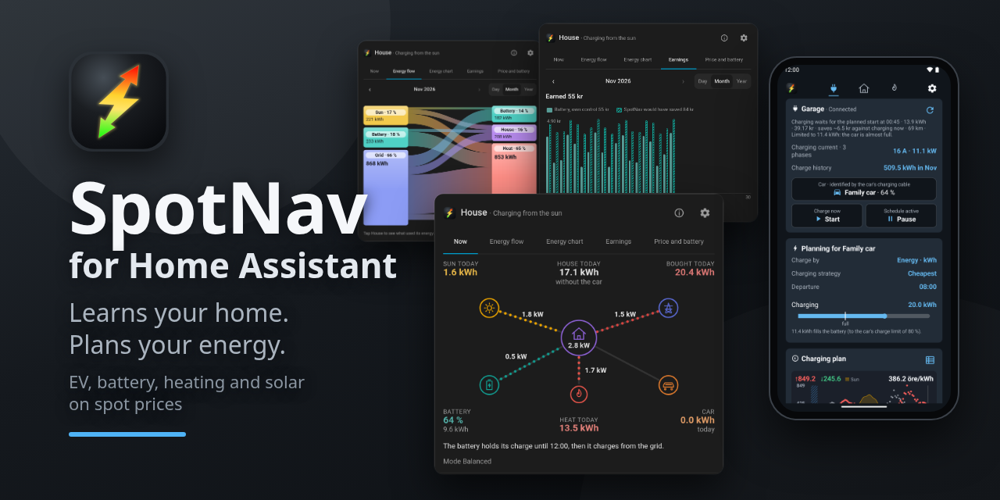
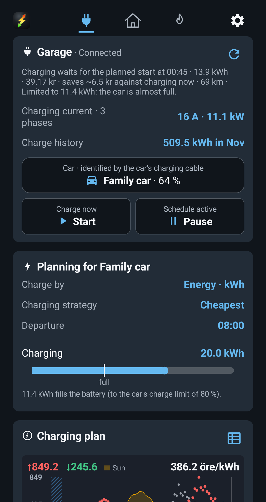
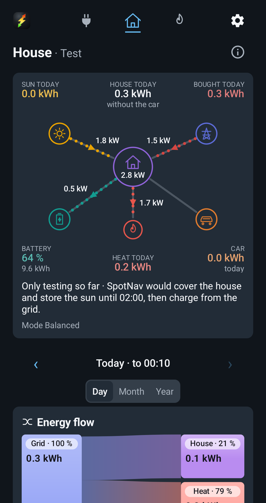
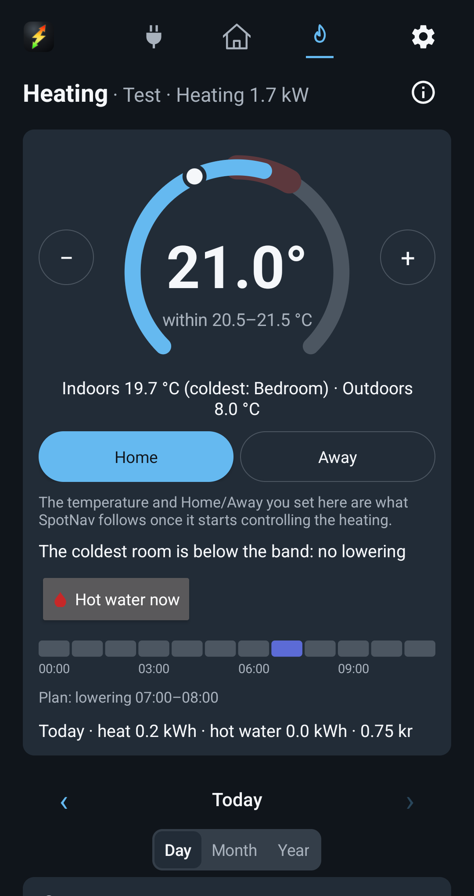

# SpotNav for Android

**Learns your home. Plans your energy.**

The companion app for [SpotNav for Home Assistant](https://github.com/henrikekblad/spotnav-home-assistant): local
control for your EV, battery and heating, planned around spot prices, solar and weather.

<p align="center">
  
</p>

**[Get SpotNav on Google Play](https://play.google.com/store/apps/details?id=se.sensnology.spotnav)** · free,
Android 8 or newer, or the APK from [Releases](../../releases).

## What it does

- **Shows what SpotNav does at home**: the charger, the car and the charging plan, and with SpotNav 3.0 also the
  house's flows, earnings and battery plan, and the heating.
- **Changes the everyday choices from your phone**: charge target, departure, Start and Pause, home and away.
- **Works without a charger**: pair with a home that only has a battery, solar or heat pump.
- **Plans on its own without Home Assistant**: the cheapest quarter-hours for a charge, from day-ahead prices with
  your own free ENTSO-E key.
- **Home-screen widget** with today's and tomorrow's prices and the charging status, in nine languages.

<p align="center">
  
  &nbsp;
  
  &nbsp;
  
</p>

## Get started

1. Install SpotNav from [Google Play](https://play.google.com/store/apps/details?id=se.sensnology.spotnav).
2. With Home Assistant: open **Settings → Home Assistant**, tap **Find Home Assistant on the network**, and approve
   the phone in Home Assistant when the six-digit codes match. The app gets one webhook ID per charger or home,
   never a Home Assistant password or token.
3. Without Home Assistant: choose your price area and add your ENTSO-E key; the app shows how to get one.

The house and heat pages need SpotNav 3.0 (beta) in Home Assistant; with 2.x the charger works as before.

**[Read the app guide](docs/app.md)**, or the whole [SpotNav documentation](https://spotnav.sensnology.se).

## Support SpotNav

- **Report a problem.** Open an issue with the [bug report form](https://github.com/henrikekblad/spotnav/issues/new/choose),
  and say which app version and phone you use. For a problem with charging control, the Home Assistant
  integration's debug info (**Settings, Support, Send debug info** in the card) helps most.
- **Contribute.** Pull requests are welcome, for code as well as translations (`app/src/main/res/values-*/strings.xml`);
  see [Build locally](#build-locally).
- **Rate the app** on [Google Play](https://play.google.com/store/apps/details?id=se.sensnology.spotnav). A review helps
  others decide.
- ⭐ **Star the repository.** Stars help others find SpotNav on GitHub.
- 💖 **Sponsor.** If SpotNav saves you money, [GitHub Sponsors](https://github.com/sponsors/henrikekblad) takes a
  one-time or monthly contribution and keeps the project going.

The app has no account, no advertising and no analytics. See [PRIVACY.md](PRIVACY.md) and the
[terms of service](https://spotnav.sensnology.se/terms).

## Build locally

Requires JDK 17 and Android SDK 36.

```bash
./gradlew assembleDebug
```

The APK is written to `app/build/outputs/apk/debug/`.

## License

[MIT](LICENSE). Copyright Sensnology AB. SpotNav is not affiliated with ENTSO-E, the ECB, Nord Pool, electricity
retailers or grid operators; prices and plans are guidance only.
