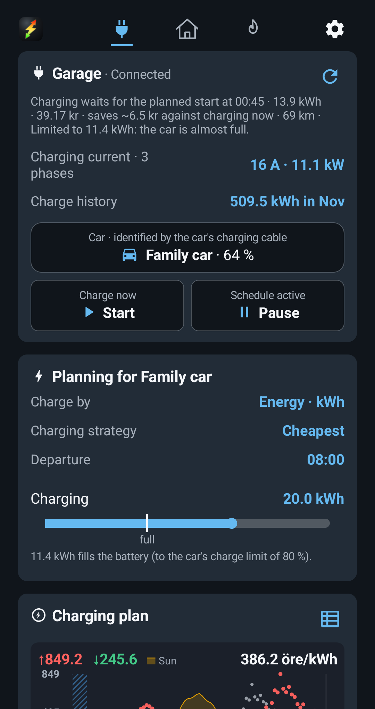

# SpotNav for Android

**Learns your home. Plans your energy.**

Local control for your EV, battery and heating, planned around spot prices, solar and weather. Built for Home Assistant.

**[Get SpotNav on Google Play](https://play.google.com/store/apps/details?id=se.sensnology.spotnav)** · free, Android 8 or newer

SpotNav is a HEMS (home energy management system) that runs inside your own Home Assistant. The Android app is its
companion: it shows what SpotNav plans and does at home, and lets you change the everyday choices from your phone.

## Two ways to use the app

- **With Home Assistant.** Pair the app with the SpotNav integration. The app then shows the charger, and with
  SpotNav 3.0 also the house and the heating, as Home Assistant runs them.
- **Without Home Assistant.** The app plans a charge on its own from the day-ahead prices. It does not control a
  charger. You need a free ENTSO-E key for the prices.

## The guide

1. [Getting started](app/getting-started.md): install, pair with Home Assistant, or use the app on its own.
2. [The charger page](app/charger.md): status, the car, planning, the price chart and the charge history.
3. [The house page](app/house.md): live flows, the energy chart, earnings, prices and the battery.
4. [The heat page](app/heat.md): the thermostat dial, home and away, the plan and the heating's use.
5. [Settings](app/settings.md): every card in Settings and what it changes.
6. [The widget](app/widget.md): prices and the charging status on the home screen.
7. [Notifications](app/notifications.md): charging events, through the Home Assistant app or this app.
8. [Privacy](app/privacy.md): what the app sends, and where.
9. [FAQ](app/faq.md): common questions.

The Home Assistant side (installing SpotNav, chargers, meters, batteries and heat pumps) is in the
[SpotNav documentation](https://spotnav.sensnology.se).
