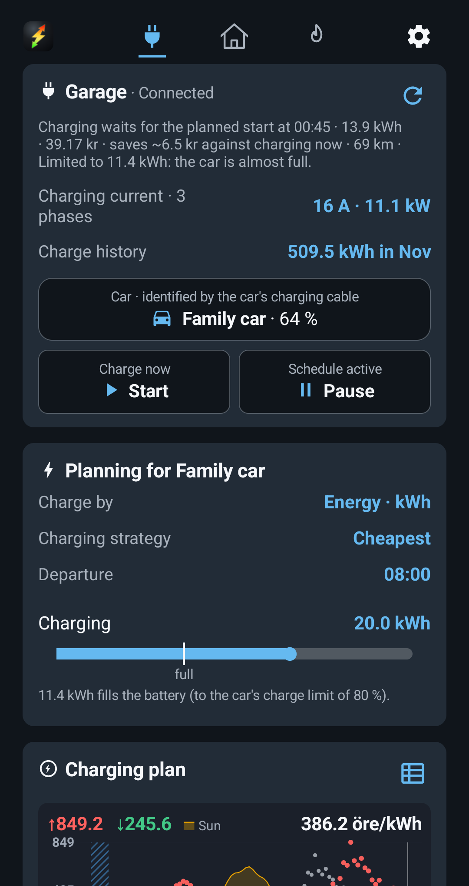
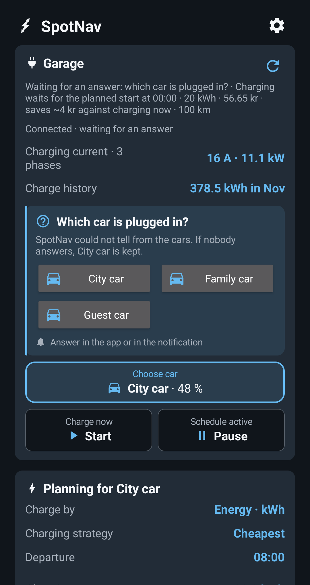
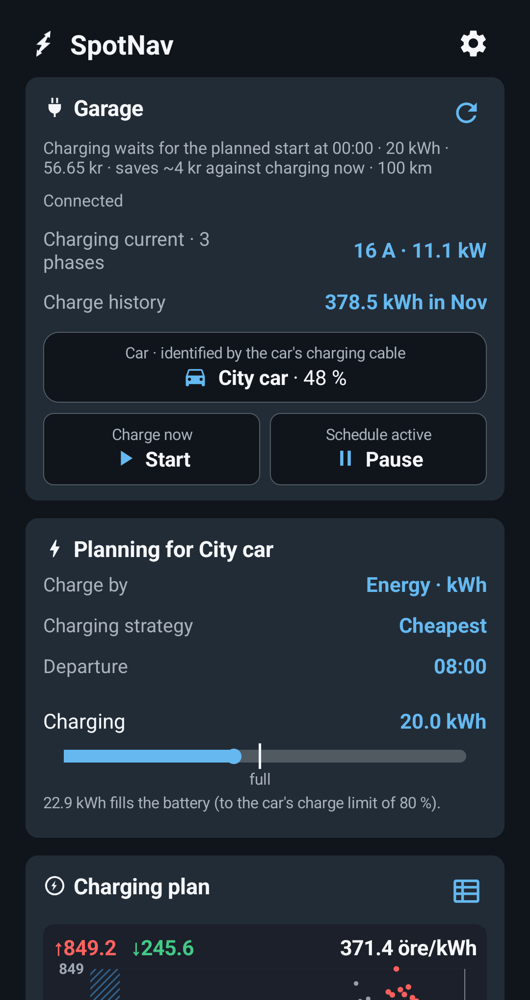
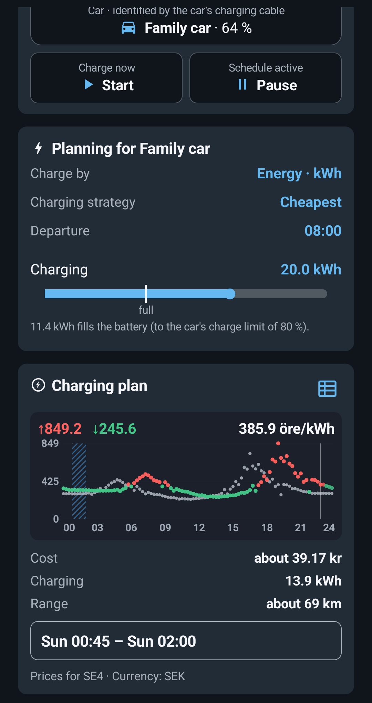
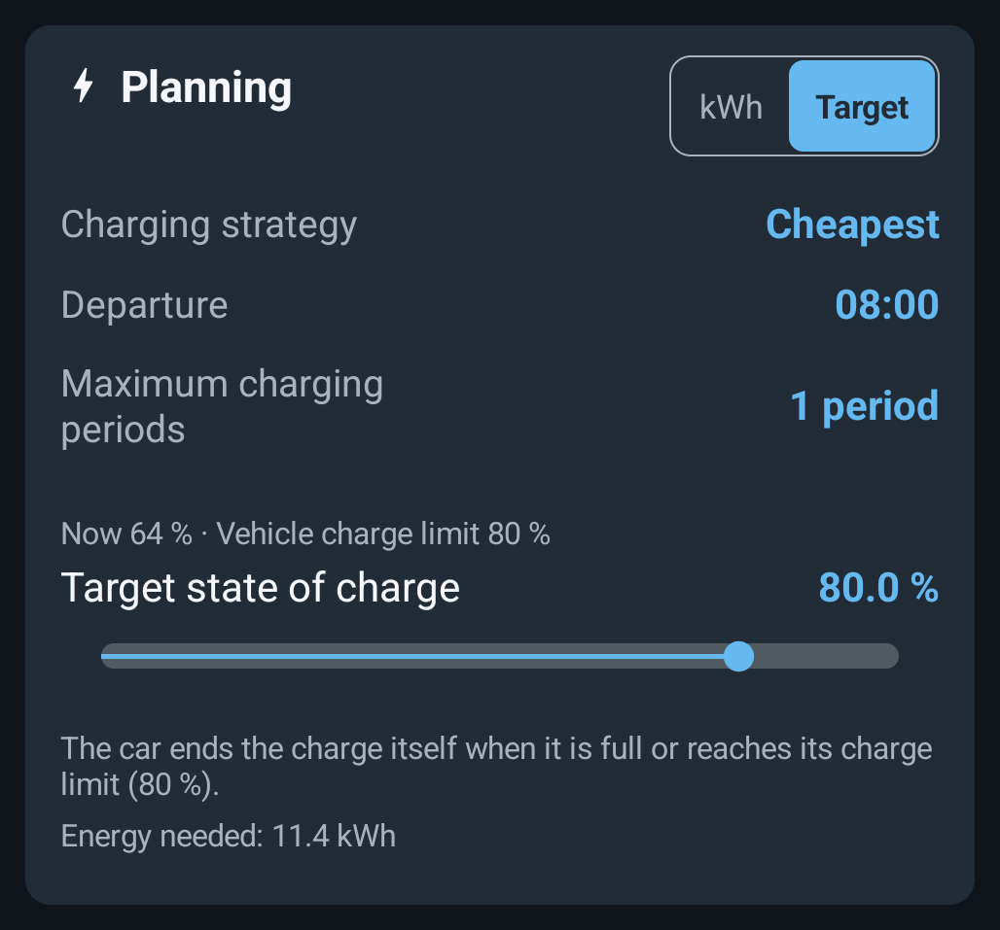
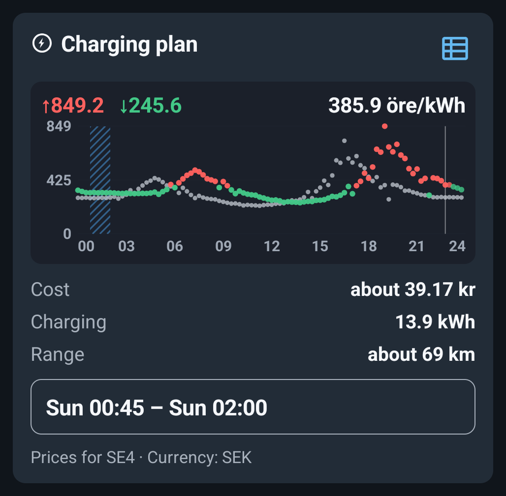
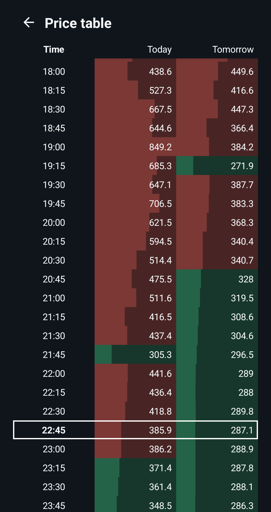
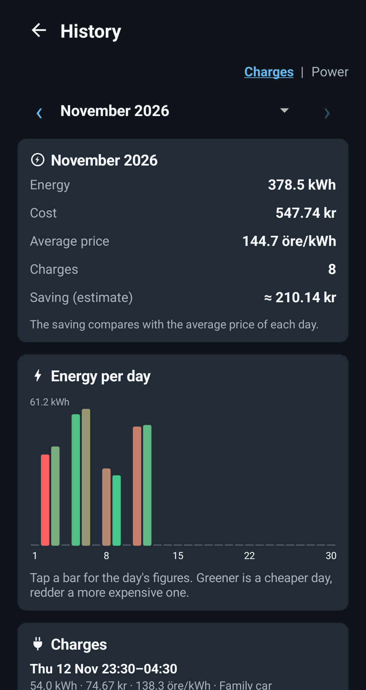

# The charger page

The charger page is the first page. Paired with Home Assistant, it shows the charger as SpotNav in Home Assistant
runs it. The words are the same as on the SpotNav card in Home Assistant.

## Charger

- **Name and connection.** The charger's name with its connection after it, for example *Garage · Waiting*.
- **Status line.** What is happening and why. Some examples:
  - *Charging to the minimum level (30 %)*: the car is below its minimum charge level and charges at once.
  - *Solar · surplus available (4.2 kW)* or *Solar · 1 phase · 2.9 kW*: the Solar strategy follows the sun.
  - *Waiting for Thursday's prices (at 13:00), which have been 41 % cheaper over the last 4 weeks*: the plan leaves
    part of the charge for cheaper hours.
  - *Stopped at 80 % at 07:31*: the charge reached its target. *(estimated)* is added when SpotNav stopped on its
    own estimate rather than the car's reading.
- **Charging current and phases.**
- **This month's charged energy.** Tap it for the [charge history](#charge-history).
- **Charge now** and **Pause.** Pause asks for how long: until the next planned period, until tomorrow, or until
  you resume.

## Which car is plugged in?

Where more than one car can charge at the charger, Home Assistant works out which one is plugged in. It uses what
the cars report and, if you set one up, the charger's camera.

- When Home Assistant cannot tell, the card asks **Which car is plugged in?** with one button per car, the likeliest
  first. The first answer wins, from the app, the Home Assistant card or a notification on any phone.
- The status line says **Identifying the car…** while Home Assistant looks, and **Waiting for an answer: which car
  is plugged in?** while the question is open.
- The car line names the car being planned for and how it was decided: by the car's charging cable, by position,
  by the camera, selected manually, or assumed. **⇄ Change car** changes it while a car is plugged in.
- **Guest car** is one of the choices. A guest car charges the **Guest amount** set in Settings.

How the camera and the identification work is in the Home Assistant documentation, under
[Which car is plugged in?]({{SITE_URL}}).

## Vehicle

The car's charge level, charge limit, battery capacity, consumption and onboard charger, as the car reports them or
as you set them. Where Home Assistant can write the charge limit, you can change it here. **Re-read in HA** asks
Home Assistant to read the car again.

## Planning

The card is titled with the car Home Assistant plans for, for example **Planning for EV6**.

- **Charge by.** **Energy · kWh** or **Target SoC · %**. Tap the value to switch. A target in percent is offered only
  when the car's charge level is known.
- **Charging strategy.** **Cheapest**, **Solar** or **Hybrid**. A strategy that needs something the site lacks says
  what, for example *Needs measured solar production*.
- **Departure.** When on, the plan must finish before this time. It can repeat every day or on chosen weekdays.
- **Energy or target.** The slider for the energy to add, or the charge level to reach.

With **Target SoC · %**, the slider marks the car's level now (**now**, or **≈ now** when estimated), its charge
limit (**limit**, below 100 % only) and, if the car has one, its minimum charge level (**min 30 %**). A target that is
already met is said once, instead of an energy of 0.0 kWh.

How the charge is split into periods is a charger setting: see [Settings → Charger](settings.md#charger).

A change to the plan shows **Plan with this change** first: the plan Home Assistant would make with it.

## Charging plan and price chart

The plan Home Assistant has installed, over the prices.

- By default (**Day**), today's and tomorrow's prices share one 24-hour axis. Tomorrow is grey. Green is below the
  day's average, red above.
- The shaded band is the planned charging: solid today, hatched tomorrow. The line is now.
- With **From now** (see [Settings → Display](settings.md#display)), the axis runs from this hour to the end of the
  last published day. Midnight is a dashed line with the new day's date.
- Where the site has solar, the chart can also draw the sun: measured before now, forecast after. Turn it on or off
  under **Settings → Display → Sun**.
- Tap the chart for a price. Tap the table button for the price table.

### Price table

Every published interval of today and tomorrow (a quarter-hour, half-hour or hour), coloured from cheap to dear,
starting at the current one.

## Charge history

A paired charger's charges, month by month:

- the month's energy, cost, average price, number of charges and solar share;
- a bar per day, greener on a cheaper day;
- every charge with its energy, cost and car.

The saving is shown two ways where Home Assistant has the figures. **SpotNav saved** compares the same energy
from the grid with charging at once on plug-in, fees included. **Saving (estimate)** compares with each day's average
price.

**Export CSV** shares the month as a file.
