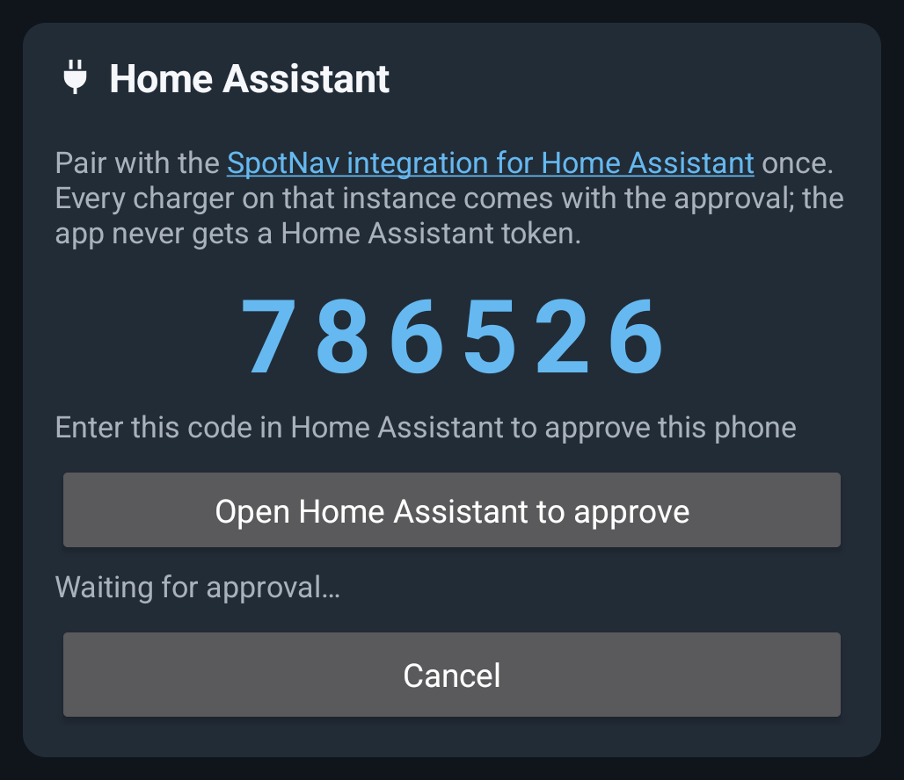
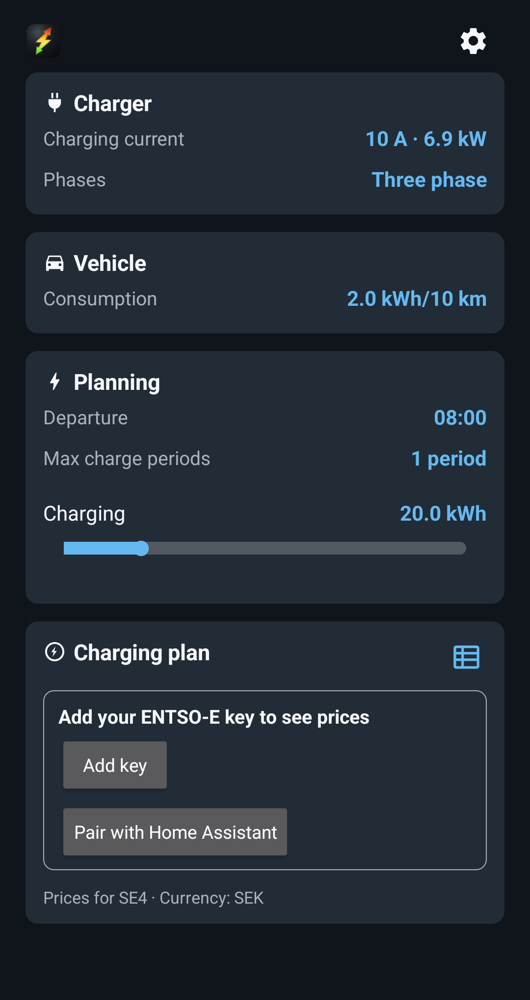

# Getting started

## Install

Install **SpotNav** from [Google Play](https://play.google.com/store/apps/details?id=se.sensnology.spotnav).
The source and the release builds are on [GitHub](https://github.com/henrikekblad/spotnav).

## Pair with Home Assistant

You need the SpotNav integration in Home Assistant with at least one charger. See the
[SpotNav documentation]({{SITE_URL}}) for the Home Assistant setup.

1. Open **Settings** (the gear at the top right) and go to the **Home Assistant** card.
2. Tap **Find Home Assistant on the network**. If nothing answers, type the address of your Home Assistant.
3. The app shows a six-digit code. Home Assistant shows the same code under **Settings → Devices & services** and
   asks you to approve the phone. Approve it there.

Every charger on that Home Assistant is paired at once. The app gets one webhook ID per charger. It never gets a
Home Assistant password or token.

### Pair again

If SpotNav in Home Assistant no longer knows the phone (for example after the integration was set up again), the
app says *SpotNav in Home Assistant no longer recognises this phone. Pair again to reconnect.* above the charger
card and in **Settings → Home Assistant**. Tap **Pair again** and approve the phone as before. A charger that comes
back under the same address keeps its settings, its widget and its notifications.

## The pages

With Home Assistant paired, the main screen has up to three pages:

| Page | Shown when |
| --- | --- |
| [Charger](charger.md) | Always. |
| [House](house.md) | The charger is on a site, and SpotNav in Home Assistant is version 3.0 or newer. |
| [Heat](heat.md) | As for the house, and the heating has something to show (a heat pump, a meter or indoor sensors). |

With two or more pages, a row of icons at the top switches between them. You can also swipe sideways on a heading
or on empty space. A swipe never starts on a slider, a chart or a button. The app opens on the page you had in view
last.

With an older SpotNav in Home Assistant, or a charger on no site, the app shows the charger page alone, with no icon
row.

## Use the app without Home Assistant

Before anything is paired, the app plans a charge by itself. It does not start or stop a charger: it shows when to
charge.

1. Choose the price area in **Settings → Electricity price**, with VAT, energy tax and grid fee.
2. Add an ENTSO-E key. Day-ahead prices may not be passed on from our server, so the app fetches them directly from
   ENTSO-E with your own free key:
   1. Create an account at transparency.entsoe.eu.
   2. E-mail transparency@entsoe.eu with the subject "Restful API access" and your account's e-mail address in the
      message.
   3. When ENTSO-E has answered, sign in, open **My Account → Web API Access** and create a key (**Generate Token**).
   4. Paste the key in the app. The app checks it with ENTSO-E before it saves it.
3. On the main screen, set the charging current and phases, the car's consumption, the departure time, how many
   charging periods may be used, and how much energy to add.

The plan picks the cheapest quarter-hours before the departure and shades them on the price chart, with the cost and
the range.

An area that ENTSO-E does not price can only be used with Home Assistant. The app says *This area needs Home
Assistant* under such an area.
