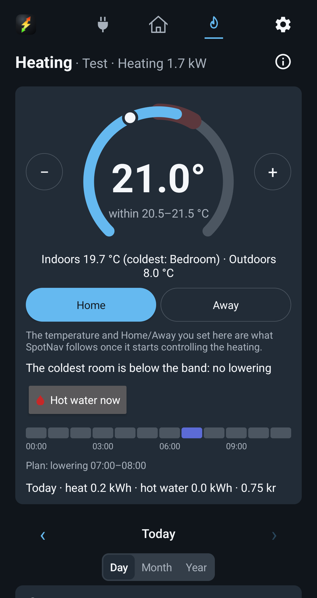
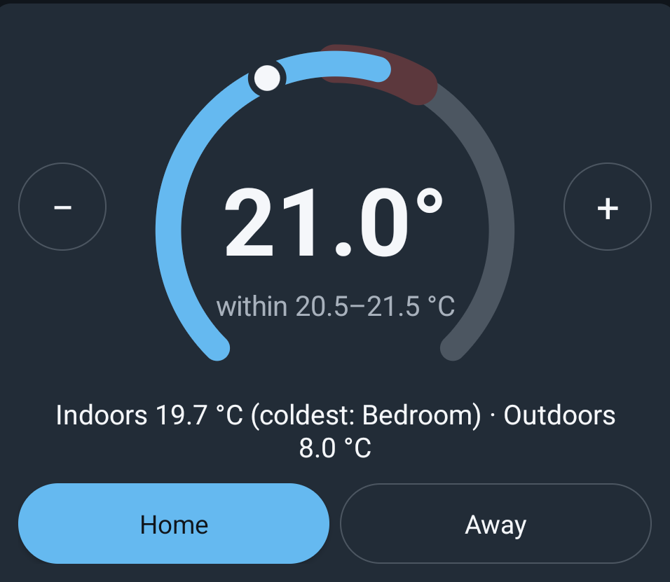
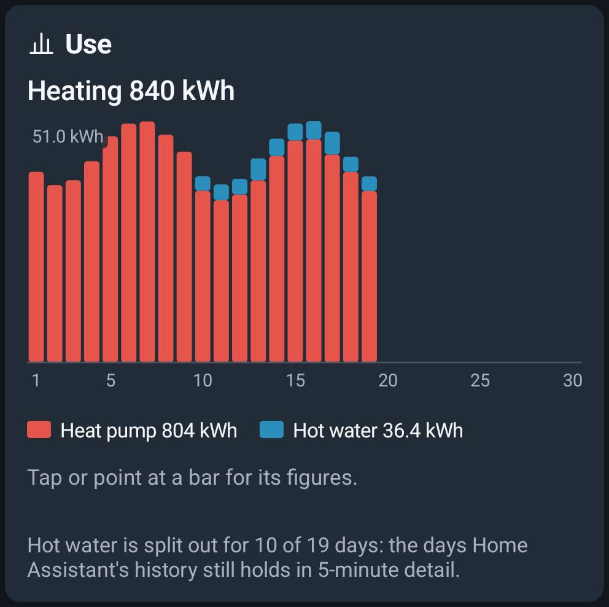

# The heat page

The heat page shows the heating as SpotNav in Home Assistant sees it. It needs SpotNav 3.0 or newer in Home
Assistant, and is shown only when the heating has something to show: a heat pump, a heat pump meter or indoor
sensors. The heating itself is set up in Home Assistant (see the [SpotNav documentation](https://spotnav.sensnology.se)).

As on the house page, the views are boxes stacked on one page. A box with nothing to show is left out.

## Test or control

Until you turn on **Control the heat** in Home Assistant, SpotNav controls nothing. The heading then shows **Test**,
and the page says what SpotNav would do, for example *Would lower to 20.5 until 18:00: expensive hours*. Nothing is sent
to the heat pump.

The temperature and Home or Away you set in the app are kept all the same. They are what SpotNav follows once it
starts controlling the heating.

## The heading

**Heating** and what the heat pump does now: heating, hot water or resting, with its power, or *Lowered until 06:00*
while SpotNav has lowered it. The **i** opens the [details](#details).

## Now

- **The dial.** The wanted indoor temperature, 16 to 25 °C in half degrees. Use **−** and **+**. The change is written
  to Home Assistant a moment after the last press. Under the figure: the comfort band (*within 20–22 °C*), the
  measured indoor temperature (with the coldest room where there are several sensors) and the outdoor temperature.
- **Home** or **Away until.** Choose **Away**, then a date and a time, at most 90 days ahead. While you are away,
  SpotNav keeps the house cooler (by the **Setback when away** in Settings, never below 16 °C) and warms it up before
  you are back. **Change** moves the return time.
- **What the heat pump does**, and what SpotNav does or would do with it, and why: expensive hours, room under the import
  target and the fuse, too warm indoors, a cooler night, away, or warming up for your return.
- **Guards**, when SpotNav holds back: *No prices yet*, *Too cold outdoors to lower*, or *The coldest room is below
  the band*.
- **A relay**, if the heat pump has one that lowers it (for example from the grid company): when it lowered the
  heating, and when it is expected to.
- **Plan**: the next 12 hours, for example *Plan: lowering 17:00–20:00, hot water 22:00*.
- **Today**: the heat, of which zones, and the hot water, in kWh.
- **Notes** you can act on, for example a heat pump that steers by the price itself, or an automation that drives
  the same relay. Turn that off where the note says, if SpotNav is to steer.

If someone else changed the temperature at the same time, the app says so and shows the latest value. Nothing is
overwritten.

## The period picker

One picker for the boxes below: **Day**, **Month** or **Year**. Without a heat pump meter, it offers days only.

## Plan

For one day: the indoor temperature (the rooms' mean and the coldest room), the setpoint, the comfort band, SpotNav's
lowerings and raises, planned lowerings ahead, the hot water, the relay's hours and the car's charging. Tap or point
at the chart for a time's figures. The box is left out when a month or a year is chosen.

## Use

What the heating used, per part, as stacked bars: **Heat pump**, **Hot water**, **Zone** and **Other heating**. Switch
the unit between kWh and cost. The headline says what SpotNav saved on heating in the period. Shown where the site
has a heat pump meter.

## Details

The **i** in the heading opens the details for the period:

- **What it cost**, with a hatched **Would have saved** part while SpotNav only tests.
- **Comfort**: hours below the band and the coldest room.
- **The heat pump per degree-day**, and **kWh per degree-day, month by month**. A step down is the house using less
  for the same weather.
- **Hot-water runs** and the **Immersion heater**.
- **The relay and SpotNav's plan**: what the relay lowered against what SpotNav would have lowered.
- **What SpotNav would have done**: the energy it would have moved out of expensive hours, and what that would have saved.
- **House model**: how far the forecast of the heating was from the meter.

Hot water is split out only for days that Home Assistant's history still holds in 5-minute detail (about ten
days).

## What the app does not change

The **Control the heat** switch, the control path (relay, SG Ready, heating curve offset or setpoint), the hot water
control and the choice of sensors and meter are changed in Home Assistant. The app shows them in
[Settings → Heating](settings.md#heating).
