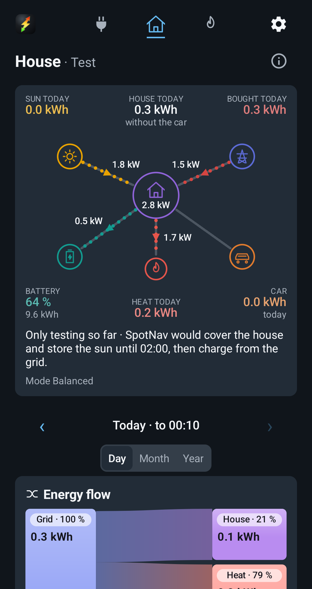
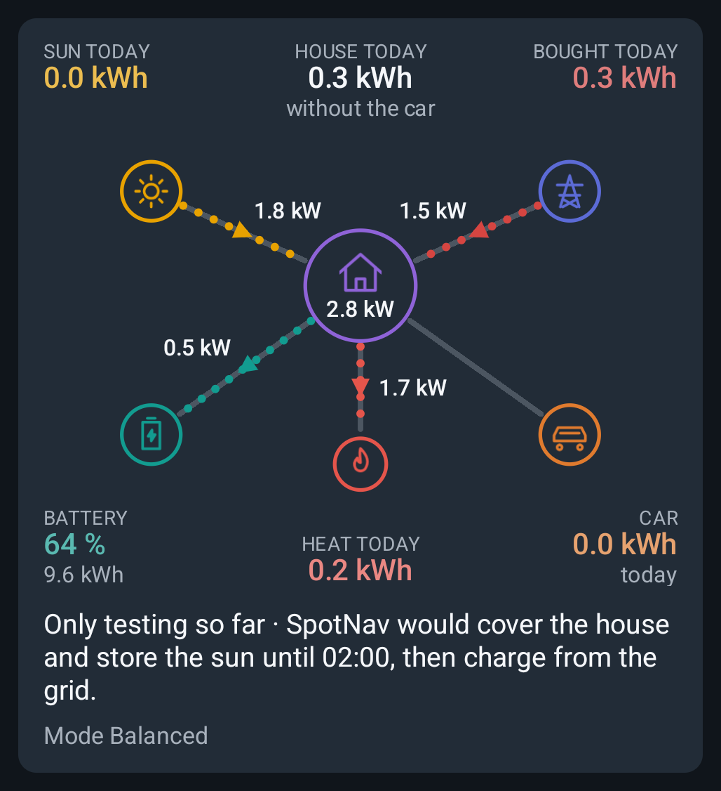
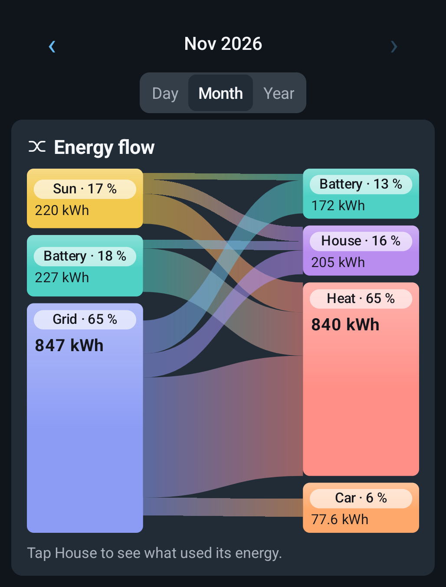
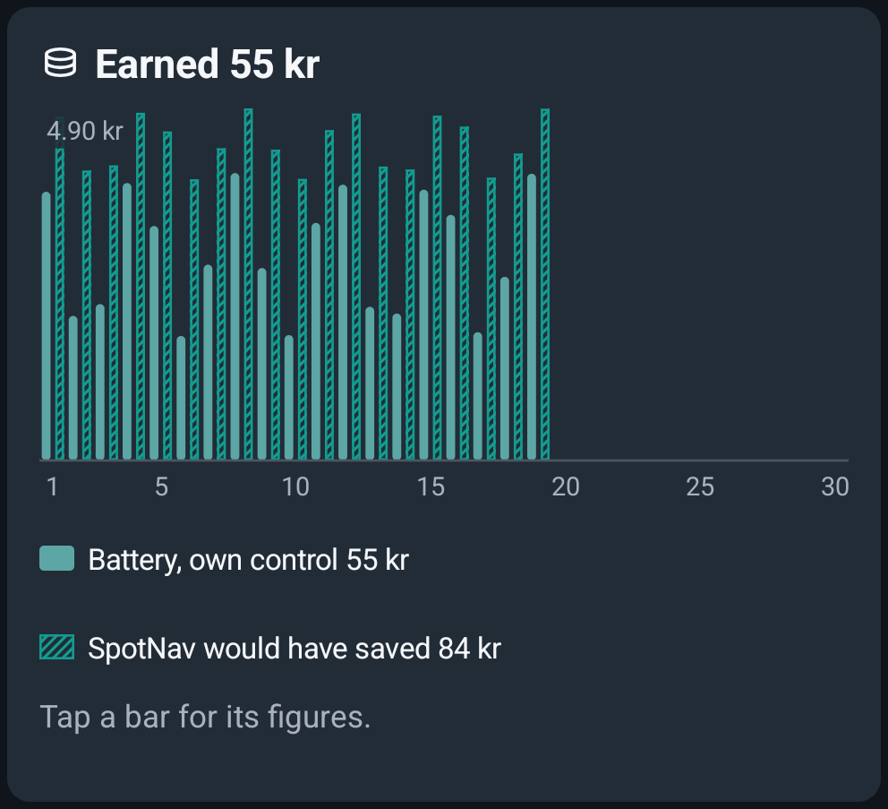

# The house page

The house page shows the whole home: the sun, the grid, the home battery, the car and the heating. It needs
SpotNav 3.0 or newer in Home Assistant and a charger on a site. It learns from the grid meter alone, so it is there
even without a battery or solar.

The page is a stack of boxes, scrolled like the charger page. A box with nothing to show is left out. The Home
Assistant card shows the same views as tabs.

## The heading

The heading says **House** and what the battery does now, for example *Holding*, *Discharging*, *Charging from the
sun* or *Idle*.

- **Test** after the name means SpotNav controls nothing here yet. It plans and shows what it would do, but sends
  nothing. Tap **Test** for the explanation. A home battery is controlled only once battery control is turned on in
  Home Assistant.
- **Own control** means the battery runs its own optimiser (for example a maker's AI mode). SpotNav plans beside it
  only to compare, and writes nothing to it.
- **Details** (the **i**) opens the [details sheet](#details).

## Now

- **A live schematic** of the sun, the grid, the battery, the house, the car and the heat, with moving dots for the
  power between them. The figures are read every 10 seconds while the page is in view.
- **One sentence on the battery**, for example *The battery holds its charge until 17:00, then it covers the house
  and stores the sun.* In test it reads *Only testing so far · SpotNav would …*.
- **Today's money**: what the battery earned and what SpotNav saved today. *(own control)* is added when the
  battery ran under its own control.
- **Today's figures**: sun today, bought today (and sold), the battery, the car, the heat and the house.
- **Notes** you can act on, for example a figure SpotNav had to assume so far.

If the live figures stop coming (three reads in a row without an answer), they are taken away, so an old power is
never shown as now.

## The period picker

Under the Now box, one picker chooses the period for every box below it: **Day**, **Month** or **Year**, with arrows
to step back and forward. Tap the date to choose one. Nothing after today can be chosen. The running period is read
again every minute.

## Energy flow

A diagram of where the energy came from and where it went in the period: sun, grid and battery on one side, house,
car, heat, battery and grid on the other. Where there is no diagram, tiles show the totals instead. A tile is never
shown for 0 kWh.

Tap **House** (or **Heat**) for **What the house used**: a pie of the house's own metered devices, with the rest as
*Unknown*. The devices come from Home Assistant's Energy dashboard, under **Individual devices**.

The meters do not say which source fed which use. SpotNav counts the sun to the house first, then the car, the
battery and the grid. The note under the diagram says so.

## Energy chart

For a day: the house's load per hour (measured before now, lighter for the forecast after), the sun as an area, and
the heat. The car is hidden at first; tap it in the legend to show it. For a month or a year: a bar per day or per
month.

Tap or drag on the chart for an hour's figures. Tap a part in the legend to hide or show it. The app remembers
the choice.

## Earnings

What was earned, per part, as stacked bars: **Arbitrage (battery)**, **Battery, own control**, **Heat** and **Car**.
The headline is the sum of the parts shown.

While SpotNav does not control the battery, a hatched part **SpotNav would have saved** shows what its plan would
have saved. That figure is worked out each night, after the day is over.

- The car's saving is counted on the day (or in the hour) its charge started.
- The heat's saving is an estimate for the whole day.

## Price and battery

For a day only: the buy price with every fee and the sell price per hour, and the battery's charge level (dashed
where it is the plan). It is shown where the site has a battery or prices.

## Details

The **i** in the heading opens the details for the period chosen in the picker:

- **Money**: the electricity cost, and what the battery and the sun saved, against the same days without them.
- **SpotNav saved**: in total, and for the battery, the car and the heat (estimated). A part SpotNav did not control
  is left out.
- **The battery's ways against self-consumption**: each battery mode planned on the same measured load and sun,
  and what the battery really did.
- **Share of perfect**: how close the battery came to the best possible in hindsight, with the same rules.
- **Forecast errors**: the house load, the sun and the battery level.
- **Day by day**, and **How it is counted** with the **Sources** SpotNav uses (weather, outdoor temperature,
  holidays, solar forecast, heat pump meter, battery).

The nightly reviews behind the savings and forecast errors are kept for 30 days.
