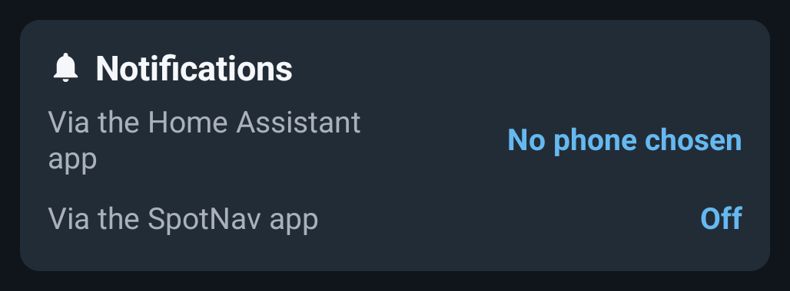

# Notifications

SpotNav can tell you about charging in two ways. Choose them in **Settings → Notifications**. Notifications need a
charger paired with Home Assistant.

## Via the Home Assistant app

The Home Assistant app (Companion) shows the notification; a tap opens Home Assistant. Choose the **Phones** and the
**Events**. Only phones signed in to the same Home Assistant with the Home Assistant app are offered.

## Via the SpotNav app

Choose **Off**, **Every 15 minutes** or **Instant**.

- **Every 15 minutes**: the app checks Home Assistant about every 15 minutes, so a notification can be up to 15
  minutes late.
- **Instant**: Home Assistant wakes the app through the SpotNav server and Google Firebase, and the app then reads
  your Home Assistant itself. The wake-up carries nothing about your charging. Offered only on phones with Google
  Play services. See [Privacy](privacy.md).

If Android has notifications turned off for SpotNav, the app says so. Allow them in the phone's settings.

## Events

| Event | Example |
| --- | --- |
| Charging stopped or did not start as planned | *Charging stopped during a planned window.* |
| The charge will not be ready by the departure | *The charge will not be ready by the departure at 07:00.* |
| Charging complete | *Charging complete: the target 80 % was reached (the car shows 81 %).* |
| Charging started | *Charging started, until 05:00.* |
| Car plugged in | *The car is plugged in.* |
| Car unplugged | *The car is unplugged.* |
| New plan | *New plan: charging from 01:00.* |
| Which car is plugged in? | One button per car (see below). |

A stopped charge, a charge that will not be ready, and the car question come on the **Charging problems** channel.
The rest come on **Charging updates**. You can set the two apart in Android's settings.

## Which car is plugged in?

Where Home Assistant identifies cars, this event is on by default in the SpotNav app. The notification has a button
per car. With more than three cars, it shows the two likeliest and a button that opens the app. A button answers at
once, also with the app closed, and the notification then says *EV6 · selected* and goes. If the question was
answered elsewhere, the app takes the notification away at its next check.

The house and the heating have no notifications in the app.
