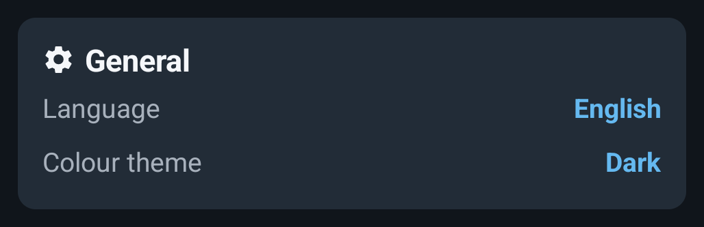
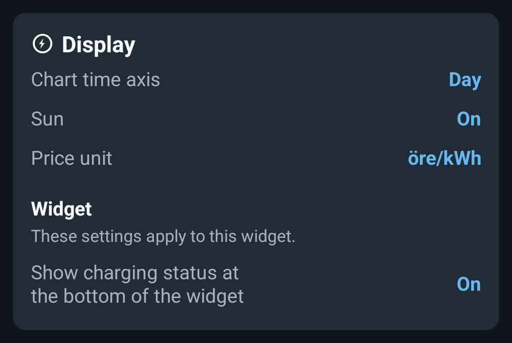
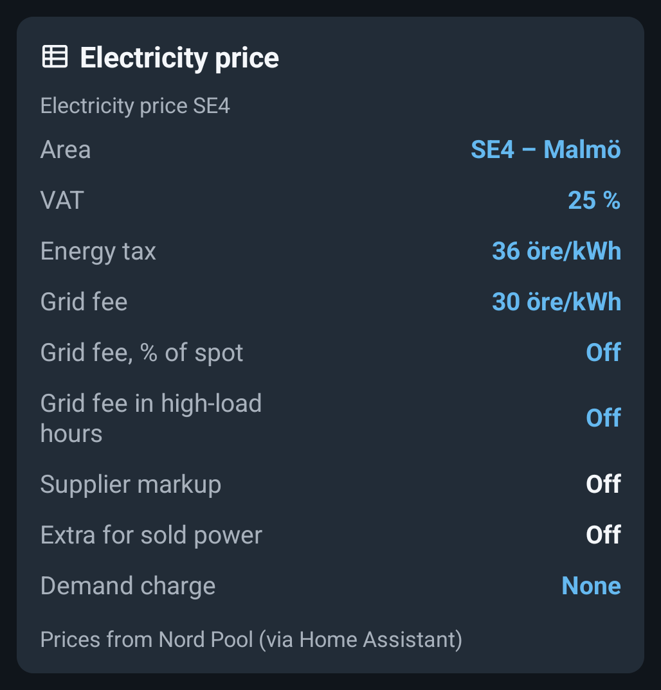
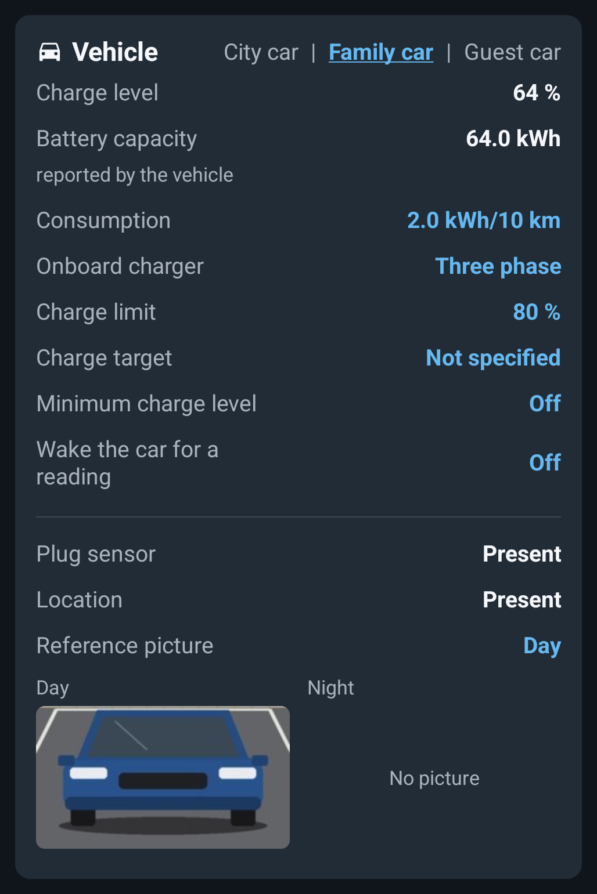
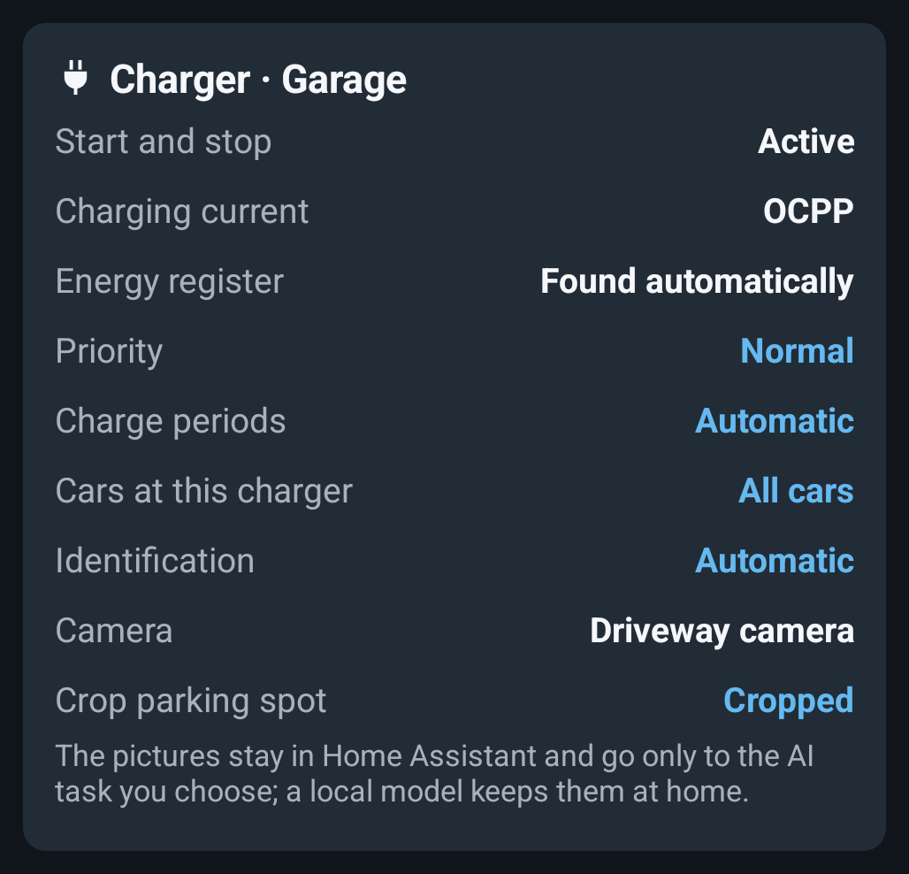
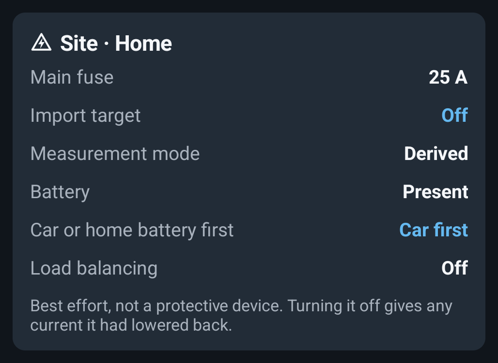
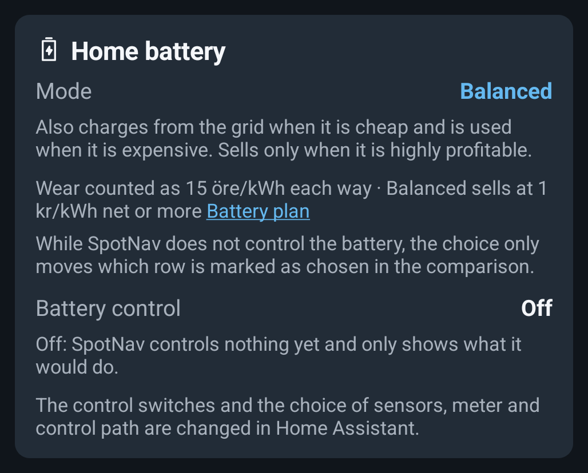
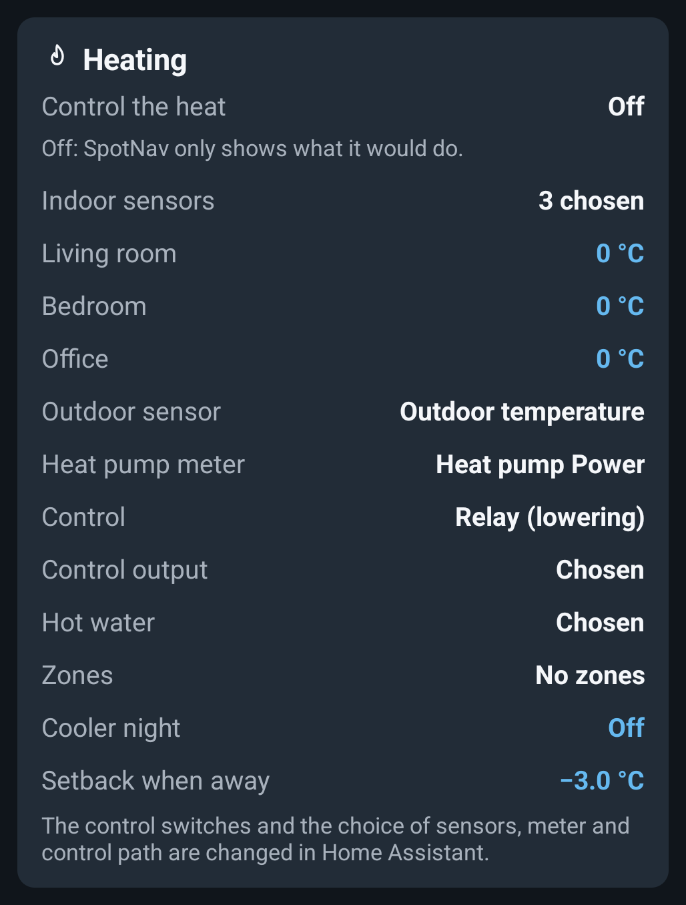
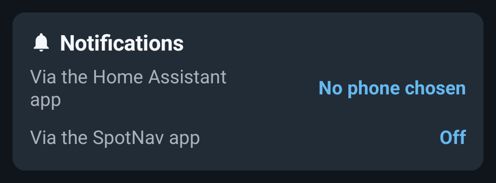
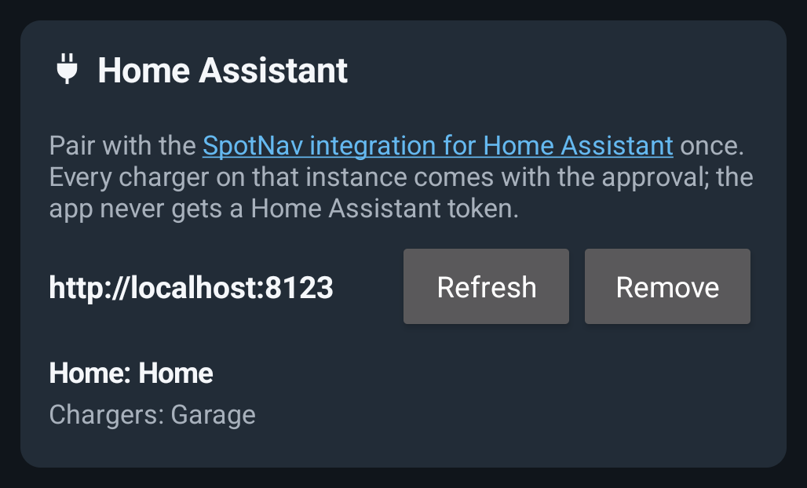

# Settings

Open **Settings** with the gear at the top right. What belongs to this phone (language, theme, the chart, the
widget) applies at once. What a paired charger owns is changed in a dialog with its own **Save**, and is written to
Home Assistant.

With several paired chargers, tabs at the top of the charger's cards choose which charger the settings are for.

## General

The app's **Language** and colour **Theme** (system, light or dark).

## Display

- **Chart time axis**: **Day** (00–24, with tomorrow drawn over today; the default) or **From now** (from this hour
  to the end of the last published day). The app and the widgets follow it.
- **Price unit**: the area's minor unit (for example öre/kWh) or its major unit (kr/kWh), where the area has both.
  Costs and savings stay in the major unit.
- **Sun**: draw the sun's power in the price chart. Shown only where the paired site has a sun to draw.
- **Widget**: the settings of the widget the app was opened from. See [The widget](widget.md).

These are this phone's own settings. They are not sent to Home Assistant.

## Electricity price

The price area, VAT, energy tax and grid fee. Prices are shown as the area publishes them: every 15, 30 or 60
minutes.

- **Without Home Assistant**, you set these here, with your ENTSO-E key.
- **Paired**, they are Home Assistant's. The card names the electricity price and how many chargers use it, and a
  change applies to all of them. With several electricity prices, **Price from** chooses the one this charger uses.
  The card also shows the grid fee's high-load hours and a demand charge, where Home Assistant has them.

## Vehicle

One tab per car. Each car has its charge level, charge limit, **Charge target**, **Minimum charge level**, battery
capacity (as reported, or learned from charging), consumption, onboard charger, plug sensor, location and
reference pictures.

- **Charge target** is the car's own, the same at every charger.
- **Minimum charge level** (Off, or 10 to 80 %): below it, Home Assistant charges at once at full current, whatever
  the strategy, unless you paused or stopped the charge.
- **Charge limit** is written to the car through its integration, where Home Assistant can do that. Nothing is
  written unless you move the slider, and at most once a minute per car.
- **Wake the car for a reading** (for cars Home Assistant can wake) asks the car for its charge level when a charge
  ends and its last report is old. It uses the car's 12 V battery, so SpotNav does it at most once per charge end.
- **Reference picture**: a day and a night picture for the camera. **Take day picture** with the car parked at the
  charger. A car with no reference picture is never recognised by the camera.

## Charger

- How Home Assistant starts and stops the charger, sets its current and reads its energy (shown).
- **Priority**: **First**, **Normal** or **Last** among the site's chargers, for power and solar surplus.
- **Phase switching for solar**: **Off** or **Automatic**. When the sun does not cover three-phase charging, the car
  charges on one phase instead of drawing from the grid. Shown only for a charger that can switch, wired for three
  phases, on a site with solar. Turn it off if your car stops charging after a phase change.
- **Charge periods**: **Automatic** (the default: the cheapest hours, split only where the saving is worth another
  start, each period at least 30 minutes) or **1 period** to **8 periods**, the most a plan may use.
- **Cars at this charger**, **Identification** (**Automatic**, **Always ask** or **Off**) and **Camera**, where
  several cars can charge. **Crop parking spot** chooses the part of the camera picture that is compared.
- **Guest amount**: what a guest car is charged with.

## Site

The main fuse, how the site's load is measured, the battery, and load balancing. Only administrators can change the
site's settings; others can read them here.

## Solar

Where the site has solar: **Car or home battery first** (who gets the sun's surplus first) and the **Solar forecast
sources**.

## Home battery

Shown where Home Assistant offers battery control (SpotNav 3.0 or newer).

- **Battery control** and its state, for example *Off: SpotNav controls nothing yet and only shows what it would
  do*, *Checking that the battery obeys (about 40 minutes)*, or *On: SpotNav runs the battery.* The switch is shown
  here but turned on and off in Home Assistant.
- **Mode**, which you can change here:
  - **Self-consumption**: the battery charges from the sun and covers the house. No trading with the grid.
  - **Balanced**: also charges from the grid when it is cheap, and is used when it is expensive. Sells only surplus,
    and only when it is highly profitable (the house's need comes first).
  - **Max profit**: like Balanced, but sells to the grid whenever it pays, wear counted in.

  While SpotNav does not control the battery, the mode only chooses which row is marked in the comparison on the
  house page.
- **The grid-charge cap**, for example *At most 6 kW from the grid, so the fuse holds even if Home Assistant stops
  (learned per phase)*. While the house's peaks are being learned, the battery does not charge from the grid.

## Heating

Shown where the site has heating in SpotNav 3.0 or newer.

You can change:

- **Cooler night**: optional, 0.5 to 3 degrees cooler between two times. The plan counts on it.
- **Setback when away**: optional, how many degrees colder the house is held while you are away. Never below 16 °C.
- **Offsets** of each zone and indoor sensor, −3 to +3 °C. A cooler upstairs: −1.5. A sensor that reads half a
  degree warm: +0.5.

Shown only, changed in Home Assistant: **Control the heat**, the indoor and outdoor sensors, the **Heat pump meter**,
the **Control** path (relay, SG Ready, heating curve offset or setpoint), its outputs, the hot water and the zones.

## Notifications

Which events notify which phones, through the Home Assistant app or this app. See [Notifications](notifications.md).

## Home Assistant

The paired Home Assistant, with **Refresh** (ask again; a charger added since is offered for pairing), **Remove**,
and **Pair again** when Home Assistant no longer knows the phone. See [Getting started](getting-started.md).

At the bottom: the app's version, **Report an issue** and **Terms of service**.
