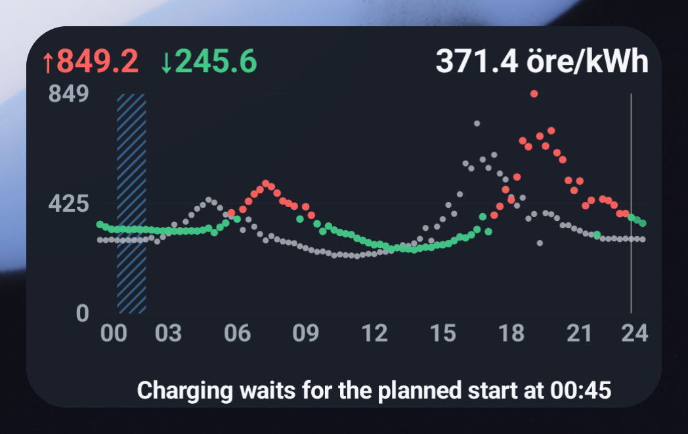

# The widget

The widget shows the price chart for today and tomorrow, with the planned charging shaded, on the same time axis as
the app (**Settings → Display → Chart time axis**). Tap it to open the app.

## Add a widget

1. Touch and hold an empty spot on the home screen, choose **Widgets**, and drag **SpotNav** to the home screen.
2. Choose the **Charger** it shows, or **No charger** for the prices alone.

Each widget has its own settings. To change them, tap the widget to open the app, then go to **Settings → Display →
Widget**:

- **Show charging status at the bottom of the widget**: the charger's status line under the chart.

## What it can say

- *Not linked — tap to choose a charger*: the widget has no charger yet.
- *Selected charger is missing*: the charger is no longer paired. Choose another, or **No charger**.
- *No charging plan available* or *Charging plan not updated*: the plan could not be read lately.
- *Add your ENTSO-E key in SpotNav*: without Home Assistant, the app needs your key for prices.

On a narrow widget the time axis keeps fewer labels. The widget shows the charger only. There is no house or heat
widget.
